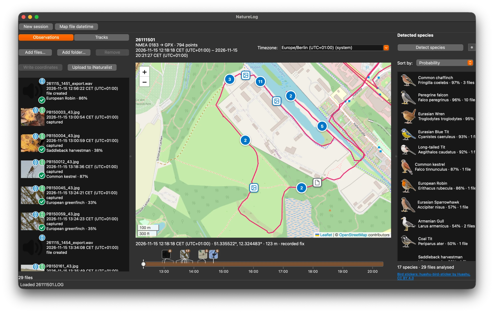

# NatureLog

Local-first desktop app for georeferenced biodiversity observations: import GPX
tracks, photos and audio, geotag media, group observations and prepare uploads
to iNaturalist.



## Setup

Requires [uv](https://docs.astral.sh/uv/) and Python 3.14+.

```bash
git clone https://github.com/igorskh/nature_log.git
cd nature_log
uv sync
uv run naturelog
```

### Species detection (optional)

Species detection uses [ChirpPipe](https://github.com/igorskh/ChirpPipe), installed
from GitHub with the `species` extra:

```bash
uv sync --extra species
```

Audio models (BirdNET v3, Perch 2) are not part of the package. Download the
`.onnx` and labels `.csv` files as described in ChirpPipe's `models/README.md`
and put them in `models/` in this project root, or point `NATURELOG_MODELS_DIR`
to the folder that holds them.

## Developing with a local ChirpPipe checkout

`pyproject.toml` pins ChirpPipe to its GitHub `main` branch (exact commit in
`uv.lock`). To work against a local checkout instead (e.g. `../chirppipe`),
layer it over the project environment without touching `pyproject.toml` or
`uv.lock`:

```bash
uv run --with-editable ../chirppipe naturelog
uv run --with-editable ../chirppipe pytest
```

Model files are then taken from the checkout's `models/` folder.

To pick up new ChirpPipe commits from GitHub:

```bash
uv lock --upgrade-package chirppipe
```

## Tests

```bash
uv run pytest
```
